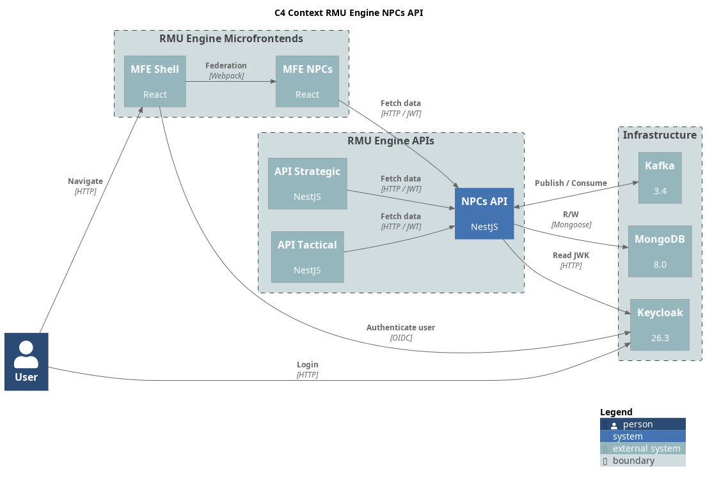

= RMU NPCs API

REST API for NPCs and creatures based on Rolemaster Unified: the Combat Stat Block of Creature Law.

This project is part of RMU Online: https://github.com/labcabrera/rmu-platform

WARNING: *This application is an independent project developed by fans of Rolemaster Unified. It is not affiliated with, endorsed by, or licensed by Iron Crown Enterprises (ICE), the owners of the Rolemaster intellectual property.*
*All Rolemaster trademarks, game systems, and materials are the property of Iron Crown Enterprises. This software is provided for personal, non-commercial use only. If you enjoy Rolemaster, please support the official publications and content from ICE.*



== Development

This API follows the platform and conventions of https://github.com/labcabrera/rmu-api-core[rmu-api-core] (workspace
specs 020 and 054): Node.js 24 (`nvm use`), pnpm 10 through corepack, native ESM with relative `.js` imports, SWC build,
Vitest and the hexagonal + CQRS layout of core's README (*Project layout*, *HTTP contract*).

```bash
cp .env.example .env   # host ports of the rmu-platform infrastructure (make up-infra)
pnpm install
pnpm start:dev         # http://localhost:3008, Swagger UI on /api-docs, OpenAPI JSON on /api-spec
make check             # lint, typecheck, unit and e2e tests
```

[cols="1,3"]
|===
| Command | What it does

| `pnpm build` / `pnpm typecheck` | SWC build to `dist/` / `tsc --noEmit`
| `pnpm lint` / `pnpm format` | typed ESLint + Prettier / Prettier over `src` and `test`
| `pnpm test` | unit tests (`test/unit`)
| `pnpm test:e2e` | one file per concern booting `AppModule` against mongodb-memory-server, with tokens signed against a local JWKS; the realm check and the Kafka producer are replaced (`test/e2e/support`)
| `pnpm test:cov` | unit and e2e tests with the coverage thresholds of `vitest.config.ts` (what CI runs)
| `make docker-build` / `make docker-run` | image `labcabrera/rmu-api-npcs:latest` (`node:24-bookworm-slim`, `node` user, `HEALTHCHECK`); `docker-run` needs `.env.docker`
| `make create-release` | semantic-release from a clean `develop` into `master`
|===

The Joi schema in `src/config/env.schema.ts` fails startup on a missing required variable. Besides `PORT` (`3008`),
`LOG_LEVEL` (`info`) and `RMU_MONGO_NPCS_URI`, the HTTP layer reads `RMU_CORS_ORIGINS`, `RMU_THROTTLE_LIMIT` /
`RMU_THROTTLE_TTL_MS` and `RMU_TRUST_PROXY`, as in core. The realm check calls core (`RMU_API_CORE_URI`) with a service
token from Keycloak (`RMU_IAM_TOKEN_URI`, `RMU_IAM_CLIENT_ID`, `RMU_IAM_CLIENT_SECRET`) through the common `HttpClient`:
no answer in `RMU_HTTP_TIMEOUT_MS` (`10000`) is a 504 `upstream-timeout`, core down or a non-2xx other than 404 is a 502.

== Model

An NPC is the Combat Stat Block of Creature Law (workspace spec 054): category, type and group, level and level spread,
outlook, archetype, modes of movement, endurance, size and critical size with the critical codes, hits and death hits,
AT/DB with the Running ranks and bonus, shield, initiative, structured attacks (OB, size class, attack table, sequences,
cooperation, katas, alternatives, poison), power points, resistances, skills with their total bonus, encounter data,
stats, free-text details, talents (informational only: no rule applies them yet), items and the book source.

`/v1/npcs` offers `GET` (RSQL, up to 1000 per page), `GET /:id`, `POST`, `PATCH /:id` and `DELETE /:id`. A `PATCH`
replaces the lists it sends (attacks, skills, movement…) whole; there are no subresources. Errors answer
`{ statusCode, error, code, message, timestamp, path }`, responses carry the `version` and a stale one in a `PATCH` is a
409 `version-conflict`. A `PATCH` without changes neither writes nor publishes. Events go to
`internal.rmu-npcs.npc.<created|updated|deleted>.v1`.

Permissions (workspace spec 073): every NPC is a child of its realm and takes the level the caller has on it in core
(owner, shares, players of its games). `rmu-admin` manages every NPC. Otherwise `read` on the realm reads and lists its
NPCs, and `write` (or owning the realm) creates, changes and deletes them; the `owner` of the NPC is only who created
it. Public NPCs are the book catalog (the generic creatures of the RMU Core realm): read with the realm, created,
changed or deleted by `rmu-admin` only, and only `rmu-admin` makes an NPC public. Lists have the NPCs of the realms the
caller reads, and every response carries `access` (`read`, `write` or `manage`). Creating in a realm without read is a
400 `realm-not-readable`, with read only a 403 `realm-not-writable`.
An NPC without realm (`realmId: null`) is global: every user reads and lists it (`access: read`), only `rmu-admin`
creates, changes or deletes it (`manage`), and creating one without the role is a 403 `global-entity-admin-only`.

The levels come from `GET /v1/realms/access?userId=` of core (service token), asked once per user and kept 30 seconds
in memory: removing a share takes up to that long to show here. Admins never ask. If core fails, the request fails
(502/504). The Kafka consumer (`RMU_KAFKA_CONSUMER_GROUP_ID`) reads `internal.rmu-core.realm.deleted.v1` and deletes
the NPCs of the realm, publishing an `npc.deleted` each; a repeated message does nothing.

Encounters (workspace spec 061): `GET /v1/encounter-tables` (summaries without rows), `GET /v1/encounter-tables/:id`
(404 `encounter-table-not-found`), `GET /v1/encounter-settings` (Tables 15.4a-c, 404 `encounter-settings-not-found`
before the import) and `POST /v1/encounters/resolve`, which is stateless: it takes every roll made so far and answers the
check, the tables walked and the result or the roll still missing (400 `invalid-encounter-modifier` or
`invalid-encounter-request`). Any authenticated user calls them. The collections `encounter-tables` and
`encounter-settings` are read-only here: the data script of the workspace fills them.

The book data is never part of this repository: it is imported into the local database from the gitignored `data/`
folder of the workspace.
